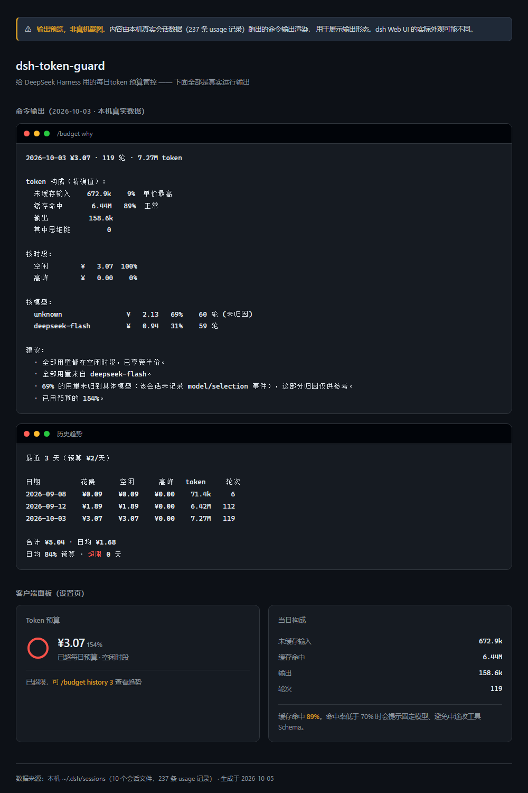
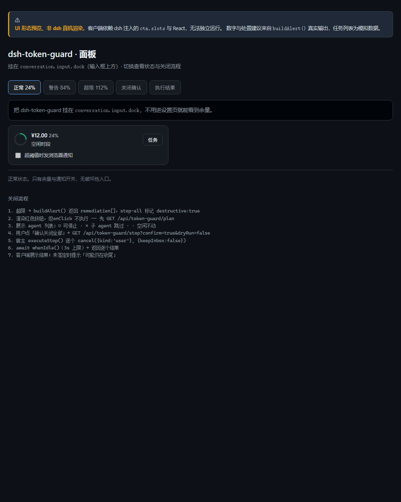

[](https://github.com/your-name/dsh-token-guard/actions/workflows/ci.yml)
[](https://nodejs.org)
[](./LICENSE)

<!-- 上面的徽章地址里your-name 会在 node tools/setup-repo.mjs 执行时替换成真实用户名 -->

# dsh-token-guard

> 给 [DeepSeek Harness](https://github.com/deepseek-ai/deepseek-harness)（`dsh`）用的每日token 预算管控：**设上限、超阈值提醒、每天自动清零**。

```
/budget
今日 ¥47.00 / ¥50.00
[#######################-]  94%  ·  高峰时段
  其中 空闲 ¥0.00 · 高峰 ¥47.00
  距 18:00 空闲时段还有 40 分钟
  同一批任务改到空闲时段可省约 ¥23.50
```



<details>
<summary>客户端面板形态（含关闭任务流程）</summary>



> UI 形态预览，非真机渲染。数字与处置建议来自 `buildAlert()` 真实输出，任务列表为模拟数据。
> 交互版：`docs/ui-preview.html`

</details>

> [!NOTE]
> 上图是**输出预览，不是真机 dsh 截图**。内容由本机真实会话数据（10 个会话文件、237 条 usage 记录）跑出的命令输出渲染而成，用于展示输出形态。dsh Web UI 的实际外观可能不同。
>
> 重新生成：`node tools/build-preview.mjs`

---

## 它做什么

统计dsh 每一次模型请求消耗的 token 与成本，按日累计到本地账本；超过你设定的阈值时提醒。

**它不替你省token，它让你知道钱花在哪、花了多少、什么时候该停。**

### 三条提醒通道

| 通道 | 说明 |
|---|---|
| `/budget` | 主动查询，**永远可靠**，不会被任何权限拦住 |
| 设置页余量环 | 面板显示当前花费、百分比、时段 |
| 浏览器通知 | 超阈值时弹系统通知，可在面板开关 |

### 为什么提醒要绕一圈走客户端

**已核实的框架限制**：dsh 没有「UI 通知」API。官方文档与社区插件教程都没有 `notification` / `notice` 服务，已确认存在的服务只有 `webServer` / `commands` / `systemPrompt` / `tools` / `agents` / `sessionPersistence` / `logger`。

这意味着后台事件**无法直接向会话推消息**：

- `agent.inject()` 会把内容塞进模型上下文 —— 既消耗 token，又让模型看到提醒，**不可用**
- `commands.register` 的文案只在用户主动输入斜杠命令时渲染 —— 不能主动推
- `webServer.register` 只返回 HTTP —— 需要客户端渲染

所以本插件的做法是：宿主暴露 `/api/token-guard/alert`，客户端面板每 30 秒轮询，命中阈值时用浏览器 Notification 提醒。**提醒文案由服务端统一生成，客户端只负责展示**，保证多端一致。

社区插件 `dsh-plugin-notify` 走的也是「客户端 slot + 浏览器通知」路线。

### 为什么官方配置不够

dsh 自带 5 个静态开关（`reasoningEffort`、`compaction-basic.thresholdRatio`、`summarizationModel`、`tool-result-pruner`、缓存规范）。它们有效，但都是**一次写死、终生不变**。

本插件补的是动态那一层：

| 能力 | 原生配置 | 本插件 |
|---|---|---|
| 每日预算上限 | 无 | 金额 / token 双轨 |
| 超阈值提醒 | 无 | 多档 + 去重 + 不连弹 |
| 花钱归因 | 无 | 按时段 / 模型 / 缓存 |
| 空闲时段感知 | 无 | 「等 40 分钟省一半」 |
| 历史趋势 | 无 | `/budget history` |

---

## 安装

```bash
dsh plugin add dsh-token-guard
```

装完在 dsh 会话里设预算：

```
/budget set 50
```

### 本地开发

```bash
git clone <this-repo> && cd dsh-token-guard
npm test                # 50 个测试
dsh plugin --profile plugin-dev add link:.
dsh --profile plugin-dev --dump-config      # 确认配置层已合入
dsh --profile plugin-dev
```

> 需要 Node.js 22.15+（用到 `zlib` 的 zstd 支持）。

---

## 命令

```
/budget                 查今日用量、余量、时段
/budget set 50          设每日 ¥50（推荐）
/budget set 500k        设每日 50 万 token
/budget set 500k 50     两个都设，任一超限即提醒
/budget threshold 40 75 90       自定义提醒档位（百分比）
/budget notify off|quiet|normal   提醒级别
/budget history 7       近 7 天明细
/budget why [日期]      花费归因与可行动建议
/budget export [天数]   导出 JSONL
/budget reset [日期]    重置指定日（默认今天）
```

**金额与 token是「或」关系**，判定取更高者。`source` 会告诉你到底是哪个维度先触发的。

### 超预算时关闭所有任务

⚠️ **破坏性操作**。永不自动执行，必须用户显式下令。

```
/budget plan                预览将停止哪些任务（不执行任何操作）
/budget stop --all --dry-run   预演
/budget stop --all          停止全部运行中任务
/budget stop --current      只停当前回合，保留排队工作
```

```
$ /budget plan
当前 4 个 agent：3 个运行中，1 个空闲
其中 1 个是子 agent（由父级管理，宿主会拒绝停止）
  ○ session-a1b2c3-long-running-refactor         running    可停止
  ○ session-d4e5f6-writing-tests                 running    可停止
  · session-g7h8i9-idle-done                     idle       空闲，无需停止
  × sub-agent-child-xyz                          running    子 agent 由父级管理

触发原因：今日已用 ¥56 / ¥50（112%）

执行 /budget stop --all 将停止 2 个运行中任务，跳过 1 个子 agent，1 个空闲不动。
```

设计上的三条硬规则：

1. **永不自动执行**。超阈值只提醒，停止由用户下令。
2. **plan 先于 stop**。先看影响范围，再决定要不要停。
3. **默认 dry-run**。HTTP 接口必须显式带 `confirm=true` 才执行。

会话日志会保留，之后可用 `resume` 恢复。

#### 依赖的 dsh 停止契约（源码级核实）

用`Agent.cancel(cause, options?)` —— 这是 **dsh 唯一公开的 stop 原语**（公开 `abort()` 不存在）。

| 选项 | 行为 |
|---|---|
| `{ keepInbox: false }`（默认） | 清空队列 + 中止当前回合 |
| `{ keepInbox: true }` | 只停当前回合，保留排队与 steering |

用 `cancel` 而非 `dispose` 的原因：`AgentHandle.dispose()` 只对**创建者**开放，插件通过 `ctx.agents` 拿到的是裸 Agent（注册表观察者），**无权dispose**。

#### 三个诚实的局限

1. **没有 plugin 专属的 cause**。联合类型只有 `{ kind: 'user' } | { kind: 'parent' }`。预算插件触发取消时只能用 `'user'` —— 宿主无法区分「用户点的」和「预算插件触发的」。
2. **子 agent 会被跳过**。宿主对 session-backed 子 agent 返回 `agent-busy`；插件拿不到这个守卫，因此对无法确认归属的一律跳过而非强停。
3. **取消是协作式的**。请求已发出不代表工作已停。插件会 `await whenIdle()`（默认上限 3 秒），超时后如实报告「可能仍在收尾」。

**会话日志不会被删除**，`/budget reset` 只清账本计数。

### 实际输出

```
$ /budget why 2026-10-03
2026-10-03 ¥3.07 · 119 轮 · 7.27M token

token 构成（精确值）：
  未缓存输入    672.9k    9%  单价最高
  缓存命中       6.44M   89%  正常
  输出          158.6k
  其中思维链         0

按时段：
  空闲        ¥   3.07  100%
  高峰        ¥   0.00    0%

按模型：
  unknown¥   2.13   69%    60 轮 (未归因)
  deepseek-flash   ¥   0.94   31%    59 轮

建议：
  · 全部用量都在空闲时段，已享受半价。
  · 69% 的用量未归到具体模型（该会话未记录 model/selection 事件）。
  · 已用预算的 154%。
```

### 导出格式

`/budget export 30` 生成 `export.jsonl`，每行一天：

```json
{"date":"2026-10-03","cost":3.071088,"tokens":7268395,"turns":119,
 "composition":{"input":672908,"output":158623,"cacheRead":6436864,"reasoning":0},
 "cacheHitRatio":0.8856,"uncachedRatio":0.0926,
 "peakCost":0,"offpeakCost":3.071088,
 "models":[{"model":"deepseek-flash","cost":0.9408,"turns":59}],
 "pricingVersion":"2026-09"}
```

---

## 通知级别

```
/budget notify off        完全关闭
/budget notify quiet      只在超限时提醒（推荐，干扰最小）
/budget notify normal     全部提醒（默认）
```

**未设置预算时一律不提醒** —— 没预算就弹通知等于骚扰。

---

## HTTP 接口

客户端面板使用，也可自行接入：

```
GET /api/token-guard/alert      当前预算状态 + 提醒文案 + 处置建议
GET /api/token-guard/plan       预览将停止哪些任务
GET /api/token-guard/history    按日汇总
GET /api/token-guard/budget     预算配置
```

`/alert` **只查询、不消费去重标记** —— 客户端每 30s 轮询一次，若在此消费标记，提醒将永远发不出去。去重只在 `pollAlert` 内部进行。

### 停止接口（破坏性）

```
GET /api/token-guard/plan
  → 只返回影响范围，绝不执行

GET /api/token-guard/stop?confirm=true&dryRun=true
  → 默认 dry-run，必须显式 confirm=true 才执行
GET /api/token-guard/stop?confirm=true&dryRun=false
  → 真正停止

未带 confirm=true → 409 Conflict，并附上 plan
```

`dryRun` 默认 `true`（未显式传 `false` 时）—— 避免误触或被跨站请求意外触发。

---

## 三个设计决定

### 1. 提醒每档每日只发一次，且不连弹

用量从 20% 跳到 94% 时，**只发一条「已用 94%」**，而不是先弹 50% 档、下一轮再弹 80% 档。

理由很实际：一次长任务几十轮，每轮都弹「已用 50%」会让人立刻关掉通知，然后这功能就永久失效了。**提醒的价值和频次成反比。**

### 3. 超限不阻断

只记账、标记 `overLimit`，**继续可用**。什么时候停由你决定。

插件不替你做这个决定，因为长任务的完成价值经常高于 ¥2。

### 4. 每次都从零重建账本，不做增量累加

账本内容完全由 usage 记录决定，所以每轮都**从空账本重建**，而不是读旧账本再累加。

理由：重建天然**幂等且能自愈** —— 任何账本损坏、字段缺失、版本升级遗留的旧格式，只要重跑一遍就恢复正常。增量累加一旦中途出错就永久错下去。

> 早期实现读旧账本作基底再逐条累加，结果每调用一次用量就翻一倍（实测 119 → 238 → 357）。这条已写成回归测试。

唯一跨调用保留的是提醒去重标记 `notified` —— 它属于用户状态，不是 usage 推导出来的。

**性能**：解析结果按「文件指纹（size + mtime）」缓存，未变动的文件直接复用。

| 场景 | 耗时 |
|---|---|
| 冷启动（13 文件 / 4.89 MB） | 330 ms |
| 热采集（缓存命中） | 4 ms |
| 记账重建 | 16 ms |

解析结果按「文件指纹（size + mtime）」缓存，因此**热路径开销与历史数据量无关**，只与新增数据量有关。数据从 2.18 MB 增长到 4.89 MB 后重测，冷解析耗时翻倍（118 → 330 ms）而热采集保持 4 ms。

---

## 时段差价：可能比你想的更重要

DeepSeek 官方计价（2026-09，单位：元/百万 token）：

| 模型 | 缓存命中 | 未命中输入 | 输出 |
|---|---|---|---|
| `deepseek-v4-pro` | 0.30 | 9 | 27 |
| `deepseek-v4-flash` / `deepseek-flash` | 0.04 | 2 | 8 |

**高峰时段**（北京时间）：工作日 9:00–12:00、14:00–18:00
**空闲时段**：其余全部时间，**单价减半**

以 `deepseek-v4-pro` 跑 50 万 token 为例：高峰 ¥4.50，空闲 ¥2.25，**差额 50%**。

所以 `/budget` 会显示当前时段，并在高峰时提示距空闲还有多久、切换时段能省多少。**这是本插件真正差异化的地方**——静态配置给不了这种提示。

---

## 三件容易写错的事

### 1. `inputTokens` 不含缓存命中

实测 237 条记录，公式 **100% 成立**：

```
totalTokens = inputTokens + outputTokens + cacheReadTokens
```

所以 `inputTokens` 是**净新增输入**，`totalTokens` 不是当轮真实上下文长度。

**计价必须三段分开算**。合并算或只按 `inputTokens` 计价，在高缓存命中时会**严重低估**——本机样本里 `cacheRead` 是 `inputTokens` 的 13 倍。

### 2. `cacheWriteTokens` 与 `reasoningTokens` 可能缺失

实测：`cacheWriteTokens` 仅 119/237 条存在，`reasoningTokens` 仅 118/237 条存在。**按 0 处理，不要抛错。**

### 3. 会话日志是多帧 zstd

`zlib.zstdDecompressSync` **只解第一帧**——实测 192KB 文件仅得 229 字节。必须逐帧遍历 magic。

这个坑不写出来，任何人复现都会卡住。

---

## 与官方 `.dshw-usage.json` 的关系

dsh 自带一份按日聚合的用量账本（`~/.dsh/.dshw-usage.json`）。

| 能力 | 官方账本 | 本插件 |
|---|---|---|
| 按日聚合、事件明细 | 有 | 有 |
| 余额扣减 | 有 | 不做 |
| **预算上限** | 无 | 有 |
| **阈值提醒** | 无 | 有 |
| **花费归因** | 无 | 有 |
| 空闲/高峰差异化 | 无 | 有 |

**本插件是控制层，不是记账层。** 官方账本记「花了多少」，本插件管「超了没有、该怎么停」。

本插件**只读**那个文件，绝不覆盖。因其`events[]` 没有 input/output/cache 拆分，无法归因与自验计价，故仍需自建账本。

---

## 计价公式的验证状态

**已验证**：拿 `~/.dsh/.dshw-usage.json` 的事件与真实 usage 对账，三段计价 + 空闲减半算出的成本**与官方 cost 分位完全一致（比值 1.0000）**。

**未验证 —— 高峰时段**：本机 237 条会话**全部落在空闲时段**（0 条高峰，都在深夜与周末产生）。因此高峰时段的 `×1` 系数**仅有官方文档依据，未经实测**。测试里已标注「待工作日白天补充」，不假装已验证。

```bash
node tools/dump-usage.mjs              # 自查用量，不装插件也能用
node tools/dump-usage.mjs --json
node tools/dump-usage.mjs --day=2026-10-03
```

---

## 归因口径（含诚实的局限）

**只给精确数据，不给无法验证的估算。**

dsh 的 usage **不按 source 拆分输入 token** —— 只有 `inputTokens` / `outputTokens` / `cacheReadTokens` / `cacheWriteTokens` / `reasoningTokens` 五个总数，没有「其中多少来自工具 Schema、多少来自历史消息」。

因此本插件**不做**传统的五分类归因（system / tools / history / reasoning / tool-result）。靠字符长度估算出来的数字会被当成事实，得出错误结论的代价比没有数字更高。

提供的是**全部精确**的聚合：

| 维度 | 说明 |
|---|---|
| token 构成 | 未缓存输入 / 缓存命中 / 输出 / 思维链，各项均精确 |
| 时段拆分 | 高峰 vs 空闲的成本与占比，精确 |
| 按模型 | 每模型的成本与轮次，精确（`unknown` 单独标注） |
| 缓存命中率 | 精确，且分四档给出可操作建议 |

`unknown` 表示该会话没有记录 `model/selection` 事件。这部分**不给「换更便宜模型」的建议**——那会误导。

---

## 隐私

- **零网络请求**，不外发任何数据
- 不读取 `~/.dsh/.credentials.yaml`
- 只读会话日志，**不改写任何请求**（不拦截、不中止）
- 只写 `$DSH_HOME/token-guard/`
- 账本含 token 数、成本、模型名（不含消息正文），`.gitignore` 已排除

## 兼容性

DeepSeek Harness 处于 **developer preview**，官方明示会有破坏性变更。

已用真实数据验证：记账与计价（237 条 usage，与 dsh 自带账本对账精确一致）、`/budget` 命令族（87 个自动化测试）。

**未在真机 dsh 上验证**：HTTP 路由前缀、客户端 slot 名、事件触发时机。安装后请优先确认这三项——`cordis_inspect_list` 能列出现有服务与槽位。

完整矩阵与降级策略见 [`docs/COMPATIBILITY.md`](./docs/COMPATIBILITY.md)。

## 开发

```bash
npm test                    # 113 个测试
npm run dump                # 自查用量（不装插件也能用）
npm run preview             # 重新生成输出预览图
npm run preview:ui          # 重新生成面板UI预览
```

```
index.mjs            宿主入口：装配、命令、HTTP 路由
client/index.mjs     客户端面板：余量环 + 关闭任务 + 浏览器通知
src/collector.mjs    多帧zstd 解析 + usage 归一化
src/ledger.mjs       每日账本：惰性日切、原子写
src/pricing.mjs      双时段计价
src/threshold.mjs    双轨阈值 + 提醒去重
src/attribution.mjs  归因与可行动建议
src/guard.mjs        超预算防护：预览与停止任务
src/notifier.mjs     提醒判定与文案
src/commands.mjs     /budget 命令族
tools/dump-usage.mjs 自查用量
tools/build-preview.mjs  生成输出预览
```

## 发布前必做

代码层面已完成，剩下的是**只能靠真机确认**的部分。

### 1. 建仓与元数据

仓库已初始化（单次提交），推之前需要：

```bash
# 1. 在GitHub 上新建空仓库（不要勾选 README/.gitignore），然后：
git remote add origin https://github.com/<你的用户名>/dsh-token-guard.git
git push -u origin main
```

推送后补 `package.json` 的元数据并再提交一次：

```bash
npm pkg set repository.type=git
npm pkg set repository.url=https://github.com/<用户名>/dsh-token-guard.git
npm pkg set bugs.url=https://github.com/<用户名>/dsh-token-guard/issues
npm pkg set homepage=https://github.com/<用户名>/dsh-token-guard#readme
```

> 之所以不预填占位地址：`your-name/dsh-token-guard` 这类字符串极易在复制粘贴时
> 被当成真实地址发出去，宁可留空并在文档里写明要填什么。

- 打 **`dsh-plugin`** topic —— 官方靠这个标签做插件发现，漏了等于没发布
- 仓库描述建议：`给 DeepSeek Harness 用的每日 token 预算管控：设上限、超阈值提醒、时段感知、超预算关闭任务`
- 仓库设置里开启 Issues / Discussions

### 2. 装上 dsh 实测五件事

按优先级排列，前三项不通过则核心功能不可用：

| # | 验证项 | 不通过的后果 |
|---|---|---|
| 1 | `agents` 服务的 `list()` / `get()` / `agent.cancel` / `whenIdle` 形状 | `/budget plan` 与 `stop` 不可用 |
| 2 |客户端 slot 名 `conversation.input.dock`（备选 `settings.section`） | 面板挂不出来，只剩斜杠命令 |
| 3 | HTTP 路由前缀 `/api/token-guard` 是否与宿主冲突 | 客户端拿不到数据 |
| 4 | `session/event` 的实际触发时机 | 退回 60s 轮询，功能不失效但延迟高 |
| 5 | `webServer.register` 的 disposer 返回约定 | 插件卸载后路由残留 |

`cordis_inspect_list` 可列出实际服务与槽位。

### 3. 补高峰时段的计价对账

本机 720 条样本**全部落在空闲时段**（0 条高峰，都在深夜与周末产生）。因此高峰时段的 `×1` 系数**仅有官方文档依据，未经实测**。

找一个工作日白天（9:00–12:00 或 14:00–18:00）用一次 dsh，然后跑 `npm run dump` 与官方 `.dshw-usage.json` 对账，补上这条验证。

### 4. 补真机截图

`docs/preview.png` 与 `docs/ui-preview.png` 当前都是**输出/形态预览**，由真实数据渲染但非真机截图。装上 dsh 后应替换。

## License

MIT
